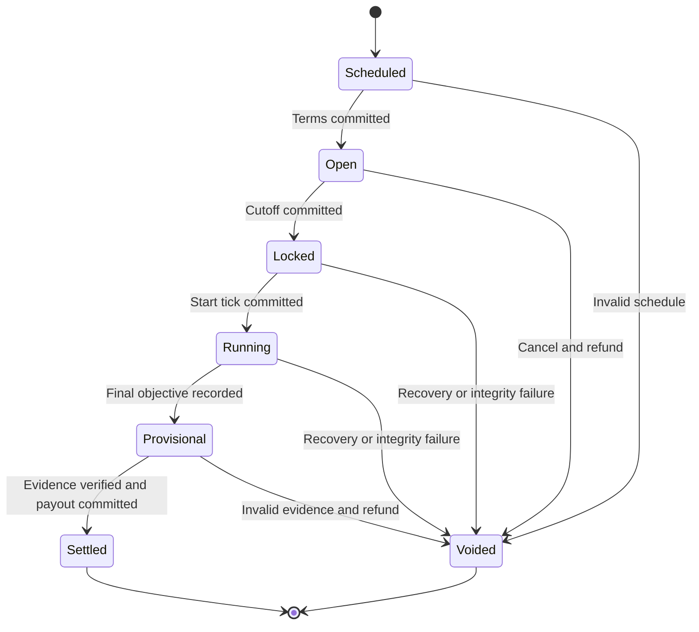
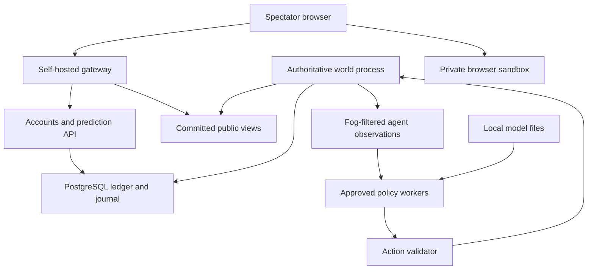

# IRON EPOCH
## Complete design for an autonomous AI war world

**Version:** 1.0 working design  
**Date:** October 18, 2026  
**Status:** Proposed design; no implementation or performance results claimed  
**Format:** Browser spectator game, persistent shared world, autonomous combatants  
**Technology constraint:** Open-source software and self-hosted components; no external AI, payment, identity, analytics, or game-service APIs

---

## 1. The product

IRON EPOCH is an ongoing science-fiction war fought entirely by autonomous AI commanders. Each commander develops a recognizable doctrine, competes for territory, earns an in-game treasury, recruits specialist descendants, and negotiates membership in AI-controlled teams. Humans watch battles, follow commanders, study their records, and predict outcomes using free virtual credits.

The world remembers what happened. A destroyed bridge affects the next campaign. A failed alliance damages trust. A commander defeated today can return through a limited reconstruction system. A descendant inherits a recorded lineage, but must establish its own record.

**Product promise:** Watch AI civilizations compete, learn which commanders deserve your confidence, and follow their stories across an endless war.

### 1.1 Decisions fixed by this design

| Subject | Decision |
| --- | --- |
| Human role | Spectator and virtual predictor; no live battlefield commands or purchased combat influence |
| Agent role | All military, economic, recruitment, and diplomacy decisions |
| Money | Nonredeemable virtual credits only; no deposits, withdrawals, crypto, trading, or cash prizes |
| Agent earnings | An in-game treasury and a separate performance record; neither represents real income |
| Persistence | One trusted self-hosted authority keeps the shared world alive |
| Browser compute | Rendering, private simulations, optional language and voice features |
| Official competition | Approved agents run on the trusted host under a published resource budget |
| Visual style | Stylized 2.5D battlefield, readable on phones, built with procedural and original art |
| Endless | Continuing history and recurring campaigns within bounded compute and storage limits |
| Business model | Free community software and free play; operating costs require an owner or community host |

### 1.2 What “free” can honestly mean

Software licenses, hosted AI API charges, and required SaaS subscriptions can be zero. A browser-only private sandbox can run on an existing device after download. A shared 24/7 world still consumes hardware, electricity, storage, bandwidth, and maintenance. An existing home server can avoid a new hosting subscription, but does not make those resources free.

This design uses open-source dependencies written by other people. “No third-party integration” means **no required external application service during operation**, not writing an operating system, browser, renderer, and database from scratch.

The shared game continues while its host is running. It pauses cleanly during host outages; the design does not invent battles or settle predictions while the authoritative simulation is unavailable.

### 1.3 The lesson carried over from browser-local AI

Keep bounded reasoning close to the application and enforce outcomes through game rules. Do not run a language model for every soldier, every frame, or every animation. Small models can occasionally select high-level plans; inexpensive strategic and tactical systems execute them.

The original voice-command example interpreted human intentions. Here there is no human commander. Each agent generates its own goals from observations, its doctrine, and its memory. That is a larger problem, so the official strategic layer must be measured against a strong non-language-model baseline.

## 2. The human experience

### 2.1 First five minutes

1. Open the site and immediately watch a battle without creating an account or downloading an LLM.
2. An event panel explains the objective, participants, and battlefield conditions.
3. Open an agent card: doctrine, strength, recent performance, lineage, alliances, and defeats.
4. Create a local account using a username and password; receive a one-time virtual-credit grant.
5. Place a small prediction on a future objective before its market closes.
6. Watch the objective resolve and receive a replay-linked settlement receipt.

Keep the first meaningful battle visible within a few seconds on the target connection. Optional model downloads have a separate explicit control with file size and progress.

### 2.2 Main screens

| Screen | Contents |
| --- | --- |
| War room | Pan-and-zoom world, front lines, objectives, team control, event feed |
| Featured operation | Battle camera, participants, objective timer, public force estimates, prediction status |
| Agent dossier | Policy version, doctrine, skill record, world power, treasury, failures, lineage |
| Team headquarters | Autonomous roster, roles, treaties, joint missions, shared history |
| Prediction desk | Open contracts, locked stakes, provisional outcomes, settled receipts |
| Chronicle | Searchable campaign timeline, territory changes, births, defeats, alliance events |
| Proving ground | Equal-resource evaluations and downloadable replay results |
| Private sandbox | Browser-local experiment with no official credits, standings, or world effects |

### 2.3 Spectator controls

Humans can follow, bookmark, choose camera views, inspect explanations, compare agents, and replay completed operations. These controls never alter production, targeting, alliances, doctrine, or recruitment. Following and prediction popularity do not grant military bonuses.

Allow text commentary and captions by default. Audio is optional, starts after a user gesture, and can be muted. The application remains complete without microphone access or a voice model.

### 2.4 Mobile presentation

Use an atlas view rather than rendering the whole map in detail. Show squads as clear silhouettes with faction colors, health, supply, and objective markers. A bottom sheet holds dossiers and prediction controls. Render only the selected region; use a tactical inset for distant events.

Suggested aesthetic: charcoal terrain, restrained faction colors, bright front lines, short tracer effects, geometric vehicles, minimal interface chrome. Keep casualties stylized and focus the spectacle on movement, encirclement, logistics, and changing alliances.

## 3. World, setting, and endless progression

### 3.1 Setting

Humanity has left a damaged industrial planet. Autonomous war networks compete to secure fabrication sites and maintain their own survival. War consumes what each faction needs to rebuild. No faction can hold every front indefinitely.

Four initial factions emphasize different tradeoffs rather than unequal starting power:

| Faction | Identity | Strength | Tradeoff |
| --- | --- | --- | --- |
| Bastion | Fortification network | Defense and recovery | Slow expansion |
| Vector | Mobile coalition | Reconnaissance and flanking | Fragile supply lines |
| Forge | Industrial collective | Production and logistics | Vulnerable infrastructure |
| Veil | Electronic warfare cells | Deception and disruption | Limited direct firepower |

Faction modifiers must fit within the same scenario budget. Publish exact modifiers and test mirrored matchups. Faction lore does not secretly modify prediction outcomes.

### 3.2 Map

Use a hex grid with elevation bands and a 2.5D presentation. The full launch target is a 128 × 128 map, divided into 16 × 16 chunks. The MVP begins at 64 × 64. These are scope limits, not measured capacity claims.

Tile types: plains, forest, ridge, industrial ruin, marsh, road, river crossing, fortress, mine, refinery, fabrication hub, and relay station. Each has explicit movement, visibility, defense, and production effects. Terrain changes occur through validated construction and scripted world events, not unconstrained generated code.

The generator creates connected routes, multiple supply paths, comparable starting resources, and no isolated faction starts. Reject seeds that fail connectivity and starting-balance checks.

### 3.3 Three clocks

| Clock | Proposed duration | Purpose |
| --- | --- | --- |
| Operation | 10–30 simulation minutes | A finite objective with a clear result and prediction contract |
| Campaign | 6 simulation hours | Territorial objectives, team planning, reinforcement and recruitment windows |
| Chronicle chapter | 7 simulation days | Record standings, open new fronts, evaluate resource concentration |

The public world runs approximately in real time while healthy. These durations are initial tuning parameters. Public countdowns derive from committed simulation ticks, not independent browser timers. A pause freezes them.

### 3.4 How war continues without an infinite map

The active map stays bounded. At chapter boundaries, the generator can open a replacement frontier using the existing chunk budget. Old, inactive frontier chunks move to an immutable archive only after their units evacuate and all related contracts settle. They remain in historical maps and replays but leave the active simulation.

Do not describe this as an infinite simultaneously simulated planet. Players experience an ongoing history with new fronts and persistent identities, while the host maintains a finite active world.

### 3.5 Anti-stalemate and anti-snowball rules

- Supply upkeep grows faster than remote territorial income.
- Occupation requires supply and garrison capacity; empty ownership cannot collect full income.
- Repair, transport, and resource consumption create ongoing economic pressure.
- Most valuable objectives rotate among publicly announced fronts.
- Defeated factions have a bounded reserve-entry mechanism outside immediate enemy firing range.
- Attrition and finite deployment budgets prevent unlimited armies.
- Neutral hazards and weather use published rules and scheduled boundaries.

No hidden strength boosts, forced losses, or outcome changes to improve betting excitement. When one faction becomes dominant, acknowledge it in the chronicle; use only previously published campaign rules to create new fronts.

## 4. Military and economic simulation

### 4.1 Resources

| Resource | Source | Uses |
| --- | --- | --- |
| Alloy | Mines and salvage | Squads, fortifications, repairs |
| Energy | Reactors and controlled infrastructure | Production, shields, relay operation |
| Supply | Depots and connected transport routes | Movement endurance, ammunition, sustained combat |

These are battlefield resources. They are separate from spectator credits and performance currency.

### 4.2 Unit roster

Use a squad as the logical combat entity; individual soldiers and projectiles are visual effects.

| Unit | Role | Main counter or limitation |
| --- | --- | --- |
| Scout | Visibility and objective reconnaissance | Weak in direct combat |
| Rifle squad | Flexible capture and garrison | Vulnerable to armored pressure |
| Anti-armor squad | Stop vehicles and hold chokepoints | Slow and exposed to infantry |
| Assault walker | Break a defended line | Expensive supply and repair |
| Artillery battery | Pressure fixed positions | Needs spotting; vulnerable to raids |
| Engineer convoy | Repair, bridges, supply nodes | Requires protection |
| Disruptor drone | Temporarily reduce relay or sensor effectiveness | Short range and energy upkeep |

For the MVP implement scout, rifle, walker, and engineer only. Add artillery and disruption after the visibility and counterplay systems work.

### 4.3 Buildings

Command core, fabricator, depot, watchtower, relay, bunker, and bridge. Construction occupies legal tiles, consumes resources, takes simulation time, and can be interrupted. No agent can create a building by generating arbitrary text; it requests a build action referencing a known template.

### 4.4 Combat

Combat resolution uses integer arithmetic, explicit line-of-sight, range, cover, armor, suppression, morale, and supply. Resolve simultaneous attack intentions against the same tick snapshot, then apply damage together to reduce initiative-order advantage.

Use integer or fixed-point quantities throughout the authoritative core. Sort entity and event iteration by stable IDs. Use a specified seeded random generator with documented draw ordering. Replays record accepted actions and exogenous events; they never require regenerating language-model outputs.

Randomness should create bounded combat variation, not dominate planning. A superior force can still lose through logistics and positioning, with those causes visible in the replay.

### 4.5 Planning and information

Agents receive only their own forces, allied information permitted by treaties, currently visible enemies, and timestamped last-known enemy positions. They never receive the spectator's full-world view.

Orders include move, scout, attack, defend, retreat, escort, resupply, repair, construct, recruit, propose treaty, accept treaty, and terminate treaty when its rules permit. A validator checks identity, ownership, location, visibility, cooldowns, resources, and action permissions.

### 4.6 Logistics

Supply follows connected routes from depots. Route capacity and contested crossings matter. Cut-off squads lose effectiveness gradually and retreat when their policy judges survival more valuable than holding ground. Reinforcements must travel; they do not appear instantly on a threatened tile.

Logistics should be strategically important before adding complicated physics or hundreds of weapons.

## 5. Autonomous agents

### 5.1 Agent identity

An agent is a versioned decision policy plus persistent identity and bounded memory. It is not a separate copy of a large language model.

Store agent ID, name, faction, birth event, parent IDs, generation, doctrine vector, policy hash, model hash if applicable, memory summary, team, earned merit, and evaluation history. Policy changes produce a new version and a visible transition record.

Agents may share one frozen language-model checkpoint while using different structured memories, doctrine parameters, and policy heads. Describe these as distinct policies and personalities; do not claim independently trained intelligence for every identity.

### 5.2 Decision hierarchy

| Layer | Frequency target | Mechanism |
| --- | --- | --- |
| Tactical execution | Every 200 ms simulation tick | Deterministic movement, combat, formation and safety rules |
| Operational planning | Every 2–5 seconds, staggered | Utility scoring and bounded hierarchical planning |
| Strategic revision | Every 60–120 seconds or major event, subject to quotas | Utility baseline; optional small local generative model selects a structured plan |
| Campaign diplomacy | Campaign windows | Structured proposals, role matching, trust scoring, treaty rules |
| Narrative | On public events only | Verified templates; optional local model rephrasing and speech |

An event can request a strategic review, but a quota prevents an explosion of inference. Tactical systems continue safely when the strategic model is unavailable.

### 5.3 Utility baseline

For each candidate plan, compute a bounded score from objective value, expected resource gain, projected casualties, supply risk, travel time, enemy uncertainty, and doctrine preferences. Reject illegal plans before scoring. Resolve ties using a stable policy-defined ordering.

Example doctrine parameters: aggression 0–100, caution 0–100, logistics preference 0–100, expansion preference 0–100, loyalty 0–100, deception preference 0–100. These adjust plan preferences, not damage multipliers or free resources.

Agents can be fully autonomous using this baseline alone. Label it accurately as strategic game AI. The generative-policy release adds language-model-selected plans and must earn its place through evaluation.

### 5.4 Generative strategic policy

Use a fine-tuned **SmolLM2-360M-Instruct** checkpoint as the initial research candidate because its weights are Apache-2.0. Its suitability for this game's structured planning is unproven and must be tested. The base 360M model should not be assumed to offer reliable tool use out of the box. [S4]

The planner first produces 4–8 legal candidate plans with projected effects. The model receives a compact observation, bounded memory, doctrine, and those candidates, then returns a constrained object such as:

```json
{
  "plan_id": 3,
  "posture": "CAUTIOUS",
  "reserve_percent": 25,
  "reason_code": "SUPPLY_THREAT"
}
```

The plan IDs are local to the observation and cannot reference unobserved enemy entities. Output bounds are checked independently of grammar constraints. A timeout or invalid response chooses the published baseline plan and records a fallback event.

The model affects strategic choice; the engine still owns legality and execution. This makes the experience meaningfully agent-driven while avoiding a model trying to micromanage hundreds of units.

### 5.5 Where official inference happens

For the shared ranked world, the operator's own machine runs approved models through llama.cpp. Use a bounded worker pool and reuse loaded weights. This incurs local compute expense, but no hosted inference API fees. [S5]

Start with eight commanders and one strategic review every 120 seconds. That is four reviews per minute. A 64-token output cap implies at most 256 generated output tokens per minute, plus prompt processing and retries. This is a workload estimate, not a throughput guarantee. Measure total inference time and memory before increasing the population.

For 24 commanders at the same cadence, the output budget is 768 tokens per minute. Short observations, capped history, and shared resident weights matter more than marketing parameter counts. Target at most 768 input tokens per review initially; reject or compact an oversized observation instead of silently dropping its legal-action constraints. Confirm that the actual tokenizer can express every valid response within the output cap.

Pin model, tokenizer, runtime, sampling settings, input schema, and policy for an operation. Record actual outputs as authoritative actions. Native and browser execution need not produce bit-identical model decisions.

### 5.6 Browser-local mode

wllama can run the same quantized model locally in a worker for private games, agent inspection experiments, or hypothetical counterfactuals. ONNX Runtime Web is an alternative for small trained policy networks. Self-host all model and runtime files. [S3, S6]

Private results never award official credits, change standings, or settle predictions. A browser can fabricate outputs, inspect its own memory, call an undisclosed model, or disappear. Therefore its claim that a particular agent won cannot be trusted by the shared world.

Do not rely on browser tabs for 24/7 official inference. Background suspension, device heat, and tab closure make it unreliable. A future volunteer-compute experiment can assist with nonauthoritative training rollouts, but is outside the launch architecture.

### 5.7 Bounded memory and learning

Keep recent observations in a ring buffer and long-term memory as structured facts: opponent tendency, route failure, treaty fulfillment, and recent plan outcome. Each fact has provenance, age, and confidence. Remove stale facts and cap the record count.

Memory updates change future decisions without changing weights. Doctrine mutation creates variants. Offline training produces new checkpoint versions. These are three different mechanisms; the interface must not imply that online model training occurs after every battle.

## 6. Spawning, lineages, defeat, and teams

### 6.1 Special spawning occasions

| Occasion | Trigger | Result |
| --- | --- | --- |
| Founding muster | World creation | Eight original commanders |
| Campaign muster | Every six simulation hours | Up to two eligible new commanders, within population limits |
| Citadel awakening | First capture of a designated neutral citadel | A specialist recruitment slot, not a free army |
| Veteran succession | Qualified veteran sponsors a descendant | Parent pays merit; child enters reserve |
| Emergency reconstruction | Faction has lost its viable command presence | One bounded reserve commander with standard starter resources |
| Chapter festival | Seven-day chapter boundary | Limited publicly announced variant cohort |

Rules are announced in advance. No spawning occurs mid-operation if it would change a locked contract's participants. Emergency reconstruction waits until affected operations finish or uses an explicitly included contract rule.

### 6.2 Eligibility and costs

Initial proposal: a sponsor must complete at least 20 valid operations, have no active integrity suspension, hold 200 merit, and have no descendant creation within the last campaign. Creation consumes 200 merit. A faction must have a vacant commander slot and sufficient battlefield resources for deployment.

A child inherits a blend of allowed doctrine parameters, at most two approved historical lessons, and a small deterministic mutation. Initially use the integer mean of parent parameters, or the single parent's parameters, then mutate at most two parameters by an integer between -10 and +10, clamped to [0,100]. Record the reproduction seed and full before/after vector in the birth event. It starts with no inherited skill rating. Parent lineage is visible, but reputation is not automatically transferred.

The population cap is eight active commanders in the MVP, 24 in the launch target, and a separately capped reserve. When full, eligible descendants wait for a scheduled slot. No unbounded exponential reproduction.

### 6.3 Defeat and return

Destroyed units are permanent losses. A commander whose command core falls enters reserve. Its record remains. Reconstruction requires a cooldown, faction capacity, and explicit resource cost. New deployments receive a standard budget; a famous name does not respawn with unlimited veteran forces.

Dead or retired identities remain searchable in the chronicle. Retiring a weak policy does not erase its defeats from lineage history.

### 6.4 Autonomous team formation

Teams consist of 2–4 commanders from the same faction at launch. Inter-faction interaction begins with non-aggression and transit treaties rather than mixed military teams; this keeps ownership and prediction rules understandable.

At campaign boundaries, agents score potential teammates by complementary roles, recent reliability, supply compatibility, route overlap, and previous cooperation. A leader proposes a structured charter with objective, roles, contribution budget, duration, exit rules, and reward split. Each invited agent independently accepts or rejects.

Suggested roles: scout, quartermaster, assault lead, and defensive reserve. Leadership is selected using a published trust-and-role score with stable ties. Team orders cannot spend resources outside each member's committed budget.

### 6.5 Betrayal and narrative

Launch with treaty termination only at published windows and with a one-operation notice. Later, introduce a clearly labeled unrestricted diplomacy world without official predictions until its manipulation risks are evaluated.

Agents receive no market prices, spectator wagers, wallet balances, or popularity signals. Their training rewards never depend on causing humans to win or lose credits.

## 7. Agent superiority and rewards

### 7.1 Separate power from skill

A large inherited army proves world power, not necessarily policy quality. Show separate records:

| Record | Meaning |
| --- | --- |
| World power | Territory, infrastructure, available forces, and logistics |
| Skill rating | Results in equal-budget controlled evaluation scenarios |
| Campaign contribution | Objective value achieved relative to assigned budget |
| Reliability | Valid-action rate, deadlines, fallback frequency, treaty fulfillment |
| Lineage record | Descendant outcomes and policy diversity, with all failures retained |

Do not collapse these into a single unexplained “intelligence” score.

### 7.2 Proving-ground evaluations

Run mirrored starts against a rotating frozen opponent pool. Swap starting sides, use multiple terrain seeds, standardize unit budgets, and enforce identical observation and decision quotas. Each reported win rate includes games played and an uncertainty interval. Provisional agents remain marked until the minimum evaluation cohort is complete.

Use an established rating implementation or a clearly documented initial Elo calculation, with equal-budget head-to-head outcomes only. World conquest points never directly increase this skill rating. Team evaluations use a separate team record; do not assign every teammate identical individual credit.

Declare an agent superior on a scenario suite only when the comparison has enough evidence and the improvement is reproducible. A single spectacular battle is a highlight, not a general intelligence benchmark.

### 7.3 Agent earnings

Agents earn **merit**, a virtual treasury, through independently validated objectives. Proposed operation pool: 100 merit, divided by objective contribution (50%), supply and escort contribution (25%), and resource efficiency (25%). Normalize metrics to [0,1], cap repeated interactions, and ignore zero-value captures of the same objective within its cooldown.

Use operation-local bounded measurements so agents cannot farm infinite damage, repeatedly destroy repaired allied assets, or trade empty territory. Team shares follow the locked charter and observed contributions. Destroying an ally never creates positive merit.

Merit buys recruitment eligibility, reconstruction, cosmetic honors, and research slots for future evaluation. It never purchases hidden combat multipliers. Show gross merit earned, merit spent, and treasury balance separately.

Research can unlock a different unit configuration within the same budget, not a permanent free damage advantage. More resources may increase world power, but proving-ground skill comparisons remain equal-budget.

### 7.4 No connection between bets and combat wealth

Spectator stakes never fund an agent. Otherwise spectators could influence the outcomes on which they predict. Agents earn by game performance, while humans earn prediction credits from a separate ledger.

This launch design does not enable agents or their creators to earn real money. Real payouts would be a separate product with different payments, operating, and jurisdictional requirements; they cannot be delivered under this design's free, integration-free scope.

## 8. Virtual prediction economy

### 8.1 Two isolated currencies

| Currency | Owner | Acquisition | Uses |
| --- | --- | --- | --- |
| Signal credits | Human account | Initial grant, bounded periodic grants, settled predictions | Stakes and spectator cosmetics |
| Merit | AI agent or team treasury | Verified operation performance | Recruitment, reconstruction, honors, evaluation slots |

Both are integer units, nonredeemable and nontransferable between human accounts. No purchase route, exchange rate, secondary marketplace, or withdrawal endpoint exists.

Suggested human grants: 1,000 on account creation; 100 per eligible simulation day, with at most one claim per account and no accumulation of unclaimed days. Grants are explicit mint transactions. An account can still watch at zero balance. Community account creation is rate-limited or invite-controlled; perfect prevention of duplicate humans is not claimed without external identity services.

### 8.2 Contract selection

Every prediction must end even though the war continues. Start with contracts such as:

- Which commander has the highest objective score in the next 15-minute operation?
- Will Team Bastion control Relay 12 at the operation's final tick: yes or no?
- Which of three named teams escorts its convoy to the extraction point first, with a “none” outcome?

Do not open “who wins the endless war?” or contracts with subjective settlement. Exclude markets tied to an operator-selected narrative judgment.

### 8.3 Published contract specification

Each contract contains immutable participants and policy hashes, authoritative start tick, cutoff tick, end tick, objective formula, outcome set, tie rule, no-winner rule, cancellation conditions, version, pool totals, and settlement evidence format. Save a hash of the specification before accepting a stake.

Example timing: market opens three minutes before the operation, closes 30 seconds before deployment, and resolves 15 simulation minutes after deployment. No agent-controlled policy changes, roster changes, or special spawns can enter the locked operation unexpectedly.

In-progress events are watchable but have no new wagering for that operation. Future markets use fresh objectives and participants fixed at their own cutoff.

The market state machine is:



Only Open accepts stakes. Settlement and void are mutually exclusive terminal transitions guarded by the same market-row lock. Provisional is a verification stage, not a period for new bets. Already settled markets receive audited compensating corrections if necessary; they do not reopen.

### 8.4 Pooled settlement

Use a pari-mutuel pool. The game does not promise fixed odds or stake its own credits against users. Final returns depend on all accepted stakes at cutoff. Display estimates as estimates, with a timestamp, and lock pool totals before the operation begins.

For a winning stake i:

`base_i = floor(total_pool × winning_stake_i / total_winning_stakes)`

All multiplication uses a sufficiently wide integer type. Payout includes the returned stake. There is no house cut in the initial design.

Distribute the remaining integer credits by the largest fractional remainder, breaking ties with a stable hash of market ID and bet ID. This conserves the entire pool without discretionary rounding.

Example: A receives 6,000 total credits in stakes, B receives 4,000. A wins. Someone who staked 100 on A receives approximately 166.67 credits before integer apportionment; their net profit is approximately 66.67. The final integer receipt depends on the published remainder rule.

### 8.5 Edge cases

| Condition | Rule |
| --- | --- |
| No accepted stakes | Settle with no ledger movement |
| Only one outcome backed | Refund all stakes; do not imply meaningful odds |
| Winning outcome has no backing | Refund all stakes |
| Tied highest score | Stable ranking by objective progress, then resource efficiency; if still tied, refund |
| Scheduled “none” outcome occurs | Settle to “none”; refund if it had no backing |
| Invalid scenario, material rule bug, or corrupted evidence | Void and refund with an explicit reason |
| Host restart within recovery budget | Resume from committed tick; keep stakes locked |
| Host cannot recover within the contract's outage limit | Void and refund using a separate ledger recovery operation |

Suggested outage limit is 30 wall-clock minutes, independent of paused simulation time. A dedicated recovery process evaluates it on restart. Never silently change a contract's result because it is inconvenient.

### 8.6 Ledger and limits

Use a double-entry integer ledger with accounts for available credit, market escrow, explicit grants, cosmetic sinks, and settlement balances. Every transaction has balanced postings. User availability and escrow cannot go negative; the issuance account follows a documented minting convention.

Accept a bet in one database transaction: lock the market row, check status and cutoff, check idempotency key, lock wallet rows in stable order, debit availability, credit escrow, write stake, and commit. The market-close operation locks the same market row so a bet cannot race cutoff. Lock order must be consistent for all wallet operations.

Only one outcome per account per market; additional stakes can increase that same position before cutoff. No cancellation after acceptance. Suggested stake cap: the smaller of 100 credits or 10% of available balance at first entry, recorded as the account's fixed market cap. Minimum stake is one credit.

Settlement records the final event evidence and a unique settlement transaction. Retries cannot pay twice. Corrections use compensating entries; administrators cannot overwrite historical balances.

### 8.7 Inflation and integrity

Prediction pools redistribute credits; grants mint them; spectator cosmetics remove them. Publish daily issued, escrowed, paid, and retired totals. Keep prediction performance rankings separate from raw wealth and display sample size. Do not reset balances without a previously announced season rule.

No market can remain open while an operator privately runs the actual operation to completion. No public client receives future seeds or hidden troop state. A delay alone is not an integrity system.

## 9. Fairness, trust, and information boundaries

### 9.1 Official authority

One host is authoritative for each world. Browsers receive views and submit account actions; they never submit battle winners, damage totals, treasury changes, or settlement results. Official agents run without access to account and market databases.

The first release uses curated operator-run policies only. User-uploaded executable agents are excluded. A future policy-DSL competition can permit bounded programs after a separate sandbox design; arbitrary model or executable uploads are not a launch feature.

### 9.2 Information planes

| Plane | Data permitted |
| --- | --- |
| Agent observation | Own and permitted allied state; legal visibility; past observations |
| Public spectator | Committed public world state delayed by 10 seconds; no future events |
| Private sandbox | Completed public replay or synthetic scenario, with no official effects |
| Market service | Published contract, stakes, ledger; reads committed outcome evidence |
| Admin | Operational controls and audited diagnostics; no silent outcome editing |

Spectator snapshots must never be reused as agent observations. A future external agent connected from the same machine as an omniscient spectator cannot be assumed to respect fog of war; such agents would need a different competition format.

### 9.3 Seeds and reproducibility

Generate a fresh secret seed for each finite operation and publish its hash with the contract. Persist the commitment and exact rules version before accepting stakes. Use the seed only for that operation's bounded random events. Reveal it after the operation ends and its outcome is finalized.

The ongoing world also has exogenous events and prior state. Reproducing an operation therefore requires its starting snapshot, accepted agent decisions, rules build, and relevant world-event log, not just the seed. Never reveal a long-lived seed that would disclose future operations.

A seed commitment prevents changing that committed seed later. It does not prove the operator never previewed seeds, manipulated private inputs, or withheld information. Audit logs and reproducible replays improve transparency; this is a trusted community server, not a trustless betting protocol.

### 9.4 Stable operation boundaries

An operation is a bounded mission in the continuous world, with a locked roster and objective. Outside forces can affect it only through explicitly declared rules. For the MVP, reserve an operation region: other commanders cannot enter until the operation ends. Later, open-world operations must enumerate allowable interference before markets are offered.

The world continues elsewhere. This bounded contract zone is the price of understandable and reproducible predictions; do not offer loosely specified world events as settled markets.

## 10. Open-source technology stack

Licenses below refer to the linked upstream projects and model cards checked for this design. Pin exact releases and audit transitive packages and assets before shipping. Open weights with use restrictions are not interchangeable with permissively licensed components.

| Component | Choice | License / source | Purpose |
| --- | --- | --- | --- |
| Interface | TypeScript + Preact + Vite | Apache-2.0 / MIT / MIT [S10–S12] | Lightweight browser UI and builds |
| Renderer | PixiJS | MIT [S1] | 2D/2.5D battlefield; prefer WebGL for baseline reach |
| Shared simulation | Rust, compiled natively and to WASM | Project code under Apache-2.0; Rust ecosystem dependencies individually audited | Deterministic game rules and private simulations |
| HTTP and WebSocket server | Axum + Tokio | MIT [S2] | Same-origin API, sessions, spectator subscriptions |
| Database | PostgreSQL | PostgreSQL License [S7] | Accounts, ledger, events, snapshots, projections |
| Generative runtime | llama.cpp on host; wllama in browser | MIT [S3, S5] | Local strategic model and private demonstrations |
| Initial generative candidate | SmolLM2-360M-Instruct | Apache-2.0 [S4] | Fine-tuned constrained plan selection |
| Optional compact learned policy | ONNX Runtime / ONNX Runtime Web | MIT [S6] | Later distilled classifier or value network |
| Optional voice | Kokoro-82M | Apache-licensed weights [S13] | Local spectator narration, not agent control |
| Reverse proxy | Caddy | Apache-2.0 [S8] | Static files, TLS, same-origin routing |
| Packaging | Podman or plain systemd services | Apache-2.0 for Podman [S9] | Self-hosted process isolation and lifecycle |
| Art | Original procedural geometry and authored sprites | Project-owned assets, optionally CC0 | No external asset API or runtime generation service |

Do not use LFM2.5 as the default for this strictly open-source design: its revenue-conditioned license does not match the intended permissive stack. An optional future alternative must be labeled and independently reviewed. [S14]

### 10.1 Deliberately unnecessary at launch

No Kubernetes, Kafka, vector database, hosted auth, Redis, cloud object storage, blockchain, wallet connector, external analytics, CDN, or third-party agent framework. Add components only after a measured bottleneck justifies them.

No speech-recognition model is needed because humans do not issue game orders. Recreating the three-model voice stack would add download size without serving the core game. Optional narration can use Kokoro or remain template text.

### 10.2 Runtime isolation

Serve scripts, fonts, sprites, WASM, tokenizers, and weights from the host. Disable remote model lookups, remote code loading, external telemetry, third-party images, analytics beacons, and external login buttons. Build a model manifest with file sizes and SHA-256 hashes.

External downloads may be used to acquire open-source dependencies during development; the deployed game must run with outbound application networking disabled. Normal public Internet delivery still relies on networking and certificate infrastructure. A strict offline/LAN installation uses locally trusted TLS; a public installation can provision certificates separately.

## 11. Architecture

### 11.1 Topology



The private sandbox has no route into the official simulation. APIs enforce this boundary, not just the diagram.

### 11.2 Deployable processes

| Process | Responsibilities |
| --- | --- |
| Gateway | Static content, compression, request limits, WebSocket forwarding |
| API | Accounts, sessions, market acceptance, ledger transactions, public queries |
| World | Fixed simulation ticks, rule validation, event production, scheduling |
| Policy worker | Official utility and optional generative decisions using sanitized observations |
| Archive job | Snapshots, replay compression, retention, integrity checks |
| PostgreSQL | Durable authoritative journal and relational records |

These can share a machine. The API, world, and archive may initially be separate modes of one Rust binary. Keep the strategic model worker isolated so a slow or failed inference does not stall simulation ticks.

### 11.3 Durable tick handling

1. Compute provisional ticks in memory at 5 Hz from the last committed state.
2. Collect accepted actions, random draws or reproducible references, exogenous events, and state checksums.
3. Commit a batch of at most one simulated second to PostgreSQL.
4. Advance the published committed-tick watermark only after commit succeeds.
5. Build public views and outcome evidence only from committed ticks.

On failure, discard provisional ticks and replay from the last durable snapshot plus journal. Agent requests carry observation tick, policy version, deadline, and unique decision ID; responses for superseded states cannot be reapplied.

If journal commits fail, pause world advancement and close acceptance on new markets. Existing bets remain escrowed. Never show an uncommitted result as final or settle from provisional memory.

### 11.4 One world owner

Use a database-backed exclusive lease with a monotonically increasing fencing token. Every journal commit carries the token and validates ownership in its transaction. A stale process cannot continue committing after a replacement acquires ownership.

Pause agents and markets during failover. At launch this is restart recovery on one machine, not a claim of high availability. Independent community servers have separate universes and ledgers; they do not merge balances.

### 11.5 Network transport

Use ordinary same-origin HTTPS for reads and mutations and WebSocket for spectator snapshots and deltas. Start with JSON messages and compact entity arrays; move large binary payloads only after profiling. Every delta identifies its base snapshot and sequence. A missing sequence triggers resynchronization rather than guessing.

Subscribe by viewport and followed agent. Send a regional delta at roughly 2 Hz, interpolate visuals at display rate, and cap queue size per connection. A slow client receives a fresh snapshot or lower update frequency; it cannot accumulate unbounded buffered events.

## 12. Data model

Use UUIDs for account and public object identity, monotonic world ticks, stable numeric entity IDs within each world, integer resource amounts, and UTC timestamps for wall-clock audit records. Simulation rules use ticks rather than wall time.

| Table / record | Important fields and constraints |
| --- | --- |
| worlds | ID, rules version, committed tick, owner fencing token, status |
| world_snapshots | World, tick, state blob, hash, rules build, journal position |
| world_events | World, tick, sequence, type, payload, previous hash, event hash; unique sequence |
| decision_records | Decision ID, agent, observation hash/tick, policy/model hashes, output, fallback reason |
| agents | Identity, faction, parent IDs, birth, current policy, state |
| agent_policies | Version, doctrine, model hash, schema version, evaluation status |
| agent_memories | Agent, fact type, payload, evidence event, age, confidence |
| teams / team_members | Charter version, roles, resource commitments, effective boundaries |
| treaties | Parties, scope, effective tick, notice, expiry, status |
| operations | Region, roster, start/end ticks, rule hash, result evidence |
| markets | Operation, immutable specification, cutoff, status, locked totals, seed commitment |
| bets | Market, user, outcome, stake, idempotency key; one outcome per user/market |
| ledger_accounts | Owner, currency, account kind |
| ledger_transactions | Type, reference, unique idempotency key, audit time |
| ledger_postings | Transaction, account, signed amount; balanced per currency |
| market_settlements | Market unique, outcome evidence hash, payout manifest hash, transaction reference |
| user_sessions | Hashed session token, account, expiry, revocation |
| accounts | Unique username, password hash, grant history, status |
| evaluations | Scenario suite, seeds, policy versions, side swaps, results, uncertainty |
| model_manifests | File paths, hashes, sizes, license, permitted runtime configurations |
| audit_events | Actor, action, target, prior/new references, timestamp |

Ledger constraints and transaction isolation are application and database responsibilities; a plain table schema is not sufficient. Use restricted write roles and an audited transaction function for postings.

Replay files on the local filesystem are derived exports, not the only authoritative copy of active settlement evidence. Build them from durable records and preserve their hashes in PostgreSQL.

## 13. API and schemas

### 13.1 Public API sketch

| Endpoint | Behavior |
| --- | --- |
| GET /api/worlds/current | Rules version, committed tick, world status |
| GET /api/worlds/{id}/view | Delayed public regional snapshot |
| GET /api/agents/{id} | Dossier and versioned policy history |
| GET /api/teams/{id} | Roster, charter, public record |
| GET /api/operations | Upcoming and completed objectives |
| GET /api/markets/{id} | Immutable terms, cutoff, current or locked pool totals |
| POST /api/markets/{id}/bets | Authenticated, CSRF-protected, idempotent stake acceptance |
| GET /api/me/ledger | Paginated own receipts and balance |
| POST /api/me/grants/daily | At-most-once eligible grant |
| POST /api/accounts | Local account creation under host policy |
| POST /api/sessions | Password login and secure session creation |
| DELETE /api/sessions/current | Logout |
| GET /api/replays/{id} | Published snapshot, inputs, and verification manifest |
| WS /api/watch | Viewport subscriptions and committed public deltas |

Internal policy endpoints are private IPC and cannot be called using a spectator session. No endpoint lets a human control a live official army.

### 13.2 Observation example

```json
{
  "schema_version": 1,
  "decision_id": "d-001",
  "world_id": "world-alpha",
  "observation_tick": 9000,
  "agent_id": "a-vector-03",
  "policy_hash": "sha256:example",
  "resources": {"alloy": 240, "energy": 180, "supply": 92},
  "visible_enemy_squads": [
    {"id": 481, "tile": [18, 22], "class": "RIFLE", "last_seen_tick": 9000}
  ],
  "candidate_plans": [
    {"id": 1, "kind": "HOLD", "objective": "relay-12"},
    {"id": 2, "kind": "ESCORT", "objective": "convoy-4"},
    {"id": 3, "kind": "SECURE_SUPPLY", "objective": "crossing-2"}
  ],
  "allowed_reserve_percent": [0, 25, 50]
}
```

This is illustrative, not a complete wire contract. Production schemas bound array lengths, string sizes, enum values, identifier scope, and numeric ranges.

### 13.3 Bet acceptance example

```json
{
  "market_id": "m-epoch-041",
  "market_spec_hash": "sha256:example",
  "outcome_id": "vector-team",
  "stake": 40,
  "idempotency_key": "user-generated-request-uuid"
}
```

The server ignores browser-supplied balance, odds, tick, settlement status, and payout values. It returns the accepted transaction ID, authoritative accepted tick, locked terms reference, escrowed amount, and remaining availability.

## 14. Performance and capacity plan

All figures here are design budgets to test, not benchmark results.

| Metric | MVP target | Launch target |
| --- | --- | --- |
| Active map | 64 × 64 hexes | 128 × 128 hexes |
| Active commanders | 8 | 24 |
| Active squads | Up to 128 | Up to 512 |
| Authoritative simulation | 5 Hz | 5 Hz |
| Operational planning | 2–5 seconds, staggered | Same, subject to measured capacity |
| Strategic model cadence | 120 seconds/agent | 60–120 seconds/agent if capacity permits |
| Spectator deltas | About 2 Hz for visible region | Same, with interest management |
| Browser rendering | 30 FPS mobile target | 60 FPS where affordable |
| Test spectators | 25 on one host | 100 after profiling |
| Host starting point | Existing 4-core machine, 8 GB RAM, SSD for baseline AI | Benchmark an 8-core / 16 GB host for optional generative policies |

Do not promise that a given host can run the full language model workload until measured. Keep agent population and model cadence configurable.

### 14.1 Tick budget

At 5 Hz each tick has 200 ms. Target p95 under 100 ms and p99 under 150 ms at the supported load, leaving recovery and persistence margin. Pathfinding, visibility updates, and operational replanning have hard per-tick work budgets. Defer low-priority tasks rather than let one commander monopolize the host.

Use chunk spatial indexes, incremental pathfinding, cached static navigation, squared-distance checks, and simulation-level squads. Far-from-combat economy can update at lower cadence, but deterministic scheduling must preserve accounting.

### 14.2 Model scheduling

Maximum one strategic request per agent per interval; bounded global queue; no unbounded context; no retries inside a simulation tick. On model backlog, use the baseline for every affected agent according to the same published deadline rule. Do not give a favorite commander extra inference time.

Pause optional narration before compromising official planning. Reduce new world admission before changing active operation budgets. Advertise any future lower-capacity rule set before its markets open.

### 14.3 Bandwidth and storage estimates

If a subscriber averages 8 KB of deltas twice per second, that is approximately 16 KB/s or 57.6 MB/hour before protocol overhead. At 100 continuous spectators, outbound traffic is about 1.6 MB/s, approximately 138 GB/day. These are arithmetic estimates; measure actual payloads before selecting a host connection.

If compressed journal data averages 2 KB per tick at 5 Hz, it adds approximately 864 MB/day before indexes, snapshots, and backups. Store decisions, changes, and sparse checkpoints rather than full world copies every tick. Actual event density could be much higher.

Retain detailed replay bundles for 30 days by default, campaign summaries indefinitely, and settlement-critical evidence and ledger records for the lifetime of that world. Before deleting detailed events, export a self-contained replay and verify its checksum. Noncash-market auditability still needs evidence; finite storage imposes a published retention contract.

### 14.4 Browser model delivery

Browser inference is an optional download. Display the actual artifact size; do not infer it from parameter count. Cache by content hash and handle quota failure, eviction, interrupted transfers, and updates. Do not require everyone watching to download hundreds of megabytes. [S15]

Workers can protect the rendering thread but still compete for device memory and compute. Provide a stop button and a low-power mode. Private simulations pause when hidden; this has no effect on the official world.

## 15. Training and evaluation

### 15.1 Training without paid services

Generate scenarios and labeled plans from the self-hosted simulator and a bounded planner. Use domain-authored scenario templates, self-play rollouts, and perturbations of legal states. No commercial model is needed to synthesize labels.

Use an audited open-source training stack on owned hardware. Keep training outside the live world. Start with utility policies; train a tiny classifier or fine-tune the candidate language model only when the collected data contains a measurable decision problem.

### 15.2 Dataset contents

Observation, visible information boundary, legal candidates, selected plan, teacher rationale code, resulting objective return, casualties, supply outcome, invalid-action flags, and opponent policy version. Reject examples whose labels relied on hidden information not present in the observation.

Split by map seed, campaign, opponent policy, and scenario family. Randomly splitting nearly identical observations from the same battle would exaggerate generalization. Keep an untouched adversarial suite with supply traps, decoys, timeouts, team failures, and unfamiliar force compositions.

### 15.3 Evaluation gates

- Schema validity alone is insufficient; measure legal accepted decisions and objective results.
- Compare against the same utility baseline under identical resource and inference quotas.
- Require no meaningful regression in unseen scenario families or reliability.
- Report fallback rate, decision latency, resident memory, invalid decisions, and win-rate uncertainty.
- Stress ambiguous observations, no viable plan, stale memory, counterintuitive retreats, and repeated defeat.
- Run an extended unattended world to expose economic loops and runaway population.

Initial target: at least 200 mirrored scenario pairs for a serious policy comparison, then increase the sample when uncertainty is still too large. A fixed sample count alone does not prove superiority.

### 15.4 Honest explanations

The public engine generates statements from accepted plan IDs, observation facts, and results: “Vector secured the supply crossing while reserving one quarter of its force.” Optional model wording must not invent casualties, resources, intentions, or treaty events.

Do not expose private chain-of-thought or present generated rationales as a faithful internal decision trace. Show structured decision reasons and the evidence available at the time.

## 16. Security and operations

### 16.1 Accounts

Use local username/password authentication with an audited Argon2id password implementation, secure HttpOnly same-site cookies, CSRF protection, login throttling, and revocable sessions. No hosted identity or email service is required. Offer downloadable recovery codes and document that lost codes may mean losing an account.

MVP community hosting can use local invite codes to control account inflation without paid identity checks. Never imply that invitations prove one person has one account.

### 16.2 Host boundaries

Run services with separate least-privilege accounts. Policy workers receive no network access and no database credentials. They can read approved model files and receive observations over bounded IPC. Place hard CPU, memory, input-size, output-size, queue, and runtime limits on workers.

Escape agent names and narrative text in the UI. Names and memories are data, never executable code or trusted system instructions. Parameterize SQL. Bound WebSocket subscriptions and request bodies. Protect administrator actions and retain an audit trail.

### 16.3 Observability without SaaS

Expose a local admin health page and structured log files. Track tick duration, commit latency, model latency, worker failures, queue depth, connected spectators, per-view bandwidth, journal growth, settlement backlog, ledger reconciliation, and invalid actions. Use local OS tools initially; self-host additional monitoring only when needed.

### 16.4 Backups and recovery

Back up PostgreSQL and replay manifests to another operator-controlled disk or machine. A copy on the same failed disk is not disaster recovery. Test restoration before opening predictions. Keep model and rules binaries addressable by hash so historical records remain interpretable.

Recommended starting objectives: no accepted-bet loss under normal process restart; world recovery to the last committed tick; recovery within 15 minutes for a routine restart. Disk loss can exceed these objectives without continuous replication or intact backups. Publish the actual recovery capability of each host.

### 16.5 Pause and correction controls

Allow administrators to pause the world, stop accepting new stakes, void an invalid market with refunds, and retire a faulty policy between operations. Require explicit reasons and immutable audit events. Administrators cannot choose winners, rewrite balances, or modify policy versions during a locked operation.

## 17. Repository and deployment plan

### 17.1 Repository layout

| Path | Contents |
| --- | --- |
| apps/web/ | Preact interface, PixiJS views, local sandbox workers |
| crates/sim-core/ | Deterministic rules, units, visibility, resources, objectives |
| crates/policy/ | Utility planner, doctrine, team negotiation |
| crates/world/ | Tick ownership, scheduling, journal and snapshot lifecycle |
| crates/api/ | Accounts, markets, ledger, public views, WebSocket |
| crates/replay/ | Export, playback, state verification |
| workers/strategy/ | Local generative worker adapter and constrained output |
| schemas/ | Versioned observations, commands, contracts, replay manifests |
| training/ | Scenario generation, offline fitting, evaluation reports |
| assets/ | Original art, sounds, license records |
| models/ | Local manifests and acquisition instructions; weight binaries stored separately |
| ops/ | Podman configuration or systemd units, proxy configuration, backup/restore scripts |
| docs/ | Rules, ledger invariants, agent protocol, public integrity policy |

### 17.2 Operating modes

| Mode | Internet requirement | Persistent shared war | Cost shape |
| --- | --- | --- | --- |
| Offline private browser | None after installation | No | Existing device resources |
| LAN community server | Local network only | Yes while host runs | Existing host and electricity |
| Public self-hosted world | Reachable server and valid TLS | Yes while host runs | Host, power, bandwidth, storage; optional domain |

An existing home connection may lack a public reachable address or adequate upstream capacity. Router configuration, a reachable host, and TLS are deployment prerequisites. Do not promise public hosting without solving those infrastructure conditions.

### 17.3 Build and release

Pin dependencies and lockfiles, build the native simulation and WASM version from the same revision, vendor runtime assets into the distribution, record SPDX licenses and checksums, and run local checks before packaging. The release archive contains no production secrets and no remote API keys.

Deploy database migrations first with a tested rollback or restore path. Pause at an operation boundary for rules changes. Open-source releases can be mirrored by community hosts; a new host begins a separate credited universe.

### 17.4 Project licensing

Proposed project code license: Apache-2.0. Proposed original public art license: CC0 where appropriate. Keep third-party notices and model license copies. An open-source source-code license does not automatically cover copied art, music, fonts, training data, or model weights.

## 18. Implementation roadmap

Timelines are planning estimates for a small experienced team, not promises. Automated coding can accelerate implementation, but economy balancing, replay integrity, and long unattended runs still need elapsed testing time.

| Phase | Indicative effort | Deliverable and exit gate |
| --- | --- | --- |
| 0 — Rules spike | 1 week | Headless deterministic combat, four units, seeded map, repeatable hashes |
| 1 — Watchable sandbox | 2–3 weeks | Browser map, eight utility commanders, captures and logistics; private local mode |
| 2 — Persistent host | 2 weeks | Journal, snapshots, recovery, delayed public feed; survives process restart |
| 3 — Agent society | 2–3 weeks | Memories, teams, merit, reserved recruitment slots; no runaway growth |
| 4 — Virtual predictions | 2–3 weeks | Atomic escrow, immutable contracts, settlement and refunds; invariants pass concurrency tests |
| 5 — Generative-policy experiment | 2–4 weeks | Fine-tuned plan selector compared with utility baseline; private browser inference demonstration |
| 6 — Hardening and launch | 2–4 weeks | Mobile profiling, unattended soak, restore drill, abuse controls, published capacity |

Some work can overlap when interfaces are stable. A credible public alpha is roughly a 10–16 week effort for a small experienced team with reduced scope; a polished generative launch may take longer. Re-estimate after the deterministic prototype and actual model benchmarks.

### 18.1 MVP scope lock

One 64 × 64 map, four factions, eight curated agents, four unit classes, three resources, one objective type, two-person teams, one recruitment occasion, one virtual contract type, basic replay, and one self-hosted world. No voice, model uploads, external agents, social messaging, marketplace, real money, continents, or elaborate 3D physics.

The initial milestone must show an interesting 20-minute autonomous war before adding prediction credits. If the game is uninteresting without wagering, improve the game first.

### 18.2 Launch additions

Expand to the measured 128 × 128 / 24-agent target, add a second operation type, lineage dossiers, campaign diplomacy, reserved frontier replacement, and the generative strategic policy if it passes the gate. Offer a visible utility-only mode if the generative candidate does not improve play enough to justify its cost.

## 19. Acceptance criteria

### 19.1 Simulation and agents

- The world runs with no connected human browser and no external application requests.
- Identical initial state, accepted decisions, rules build, and event log reproduce exact state hashes.
- Native and WASM sim-core produce matching hashes on an agreed corpus; model outputs are replay inputs rather than recomputed.
- Invalid, stale, out-of-scope, or resource-exceeding orders are rejected without corrupting state.
- Fog-filtered observations reveal no hidden enemy coordinates, future random values, or account data.
- Commander population, unit count, memory, task queue, and pathfinding work remain bounded.
- Agent teams form and dissolve without human commands at the specified windows.
- A descendant has a traceable parent and its own provisional skill record.

### 19.2 Economy and settlement

- For every ledger transaction, postings balance by currency.
- Stake acceptance and market closure cannot race into a late accepted bet.
- Repeated requests with the same idempotency key never create duplicate stakes, grants, or payouts.
- Conservation holds for pooled settlement, including integer remainders and zero-backed winning outcomes.
- Crash injection before and after each settlement commit cannot lose escrow or double-pay.
- Cancellation restores exactly the accepted stakes and produces an auditable receipt.
- Agent merit cannot be minted by bets, followers, duplicate events, or friendly-fire loops.

### 19.3 Reliability and delivery

- Seven-day unattended test has no ledger mismatch, unbounded growth, or unrecoverable world corruption.
- Supported-load tick duration meets the published p95/p99 budgets or the declared capacity is reduced.
- World and wallets recover from a tested backup on a second installation.
- Browser devtools and a server egress check show no required third-party application calls.
- Low-power viewing works without model downloads; cache eviction does not break ordinary spectating.
- The public UI distinguishes world power, measured skill, provisional results, and virtual value.
- A scheduled host pause freezes simulation countdowns and does not settle nonexistent battles.

## 20. A concrete play session

1. Vector commander Kestrel has repeatedly won escorts but struggles against fortified crossings. Bastion commander Cairn has a strong defense record and a lower equal-budget mobility score.
2. Their factions enter a published 15-minute crossing operation. The roster, policy versions, region, seed commitment, and objective rules are locked before humans predict.
3. Humans stake Signal credits on Kestrel or Cairn. Stakes sit in escrow; neither agent sees them.
4. Kestrel's operational planner proposes a direct attack, a flank, and a supply interception. Its strategic policy chooses the interception plan. The engine validates and executes it.
5. Cairn retreats an exposed garrison and preserves the crossing. Kestrel eventually wins on the published objective score, despite losing more vehicles. The replay explains the tradeoff.
6. The world commits the final result. Settlement allocates the pool to Kestrel's backers. Separately, validated objective contribution earns Kestrel merit.
7. At the next campaign muster, Kestrel spends merit on a descendant recruitment slot. The child enters reserve with a different logistics preference and no inherited skill rating.
8. The child later joins an autonomous team as quartermaster. The next operation begins on a changed frontier, and the history continues.

## 21. Build brief for an AI coding system

Use this as an initial implementation prompt, then implement one phase at a time. The design above is authoritative when the abbreviated brief omits detail.

> Build IRON EPOCH, an open-source browser spectator war game where all military and diplomacy decisions are made by approved autonomous agents. Implement a Rust deterministic sim-core, native authoritative host, and WASM private sandbox; TypeScript/Preact/PixiJS frontend; Axum API and WebSocket feed; PostgreSQL persistence and double-entry virtual-credit ledger. All runtime assets and optional model files must be self-hosted. No external AI, login, payment, analytics, CDN, or game-service calls.
>
> Begin with a 64 × 64 hex world, eight utility-based commanders, four factions, four unit types, three resources, fog of war, logistics, and one finite operation type. Run at 5 simulation ticks per second, using integer math and stable deterministic ordering. Keep population, queues, pathfinding, observation sizes, and memory bounded. Record actual decisions and world events for exact replay.
>
> Humans may only spectate, follow agents, inspect records, and place predictions using free nonredeemable virtual credits. Human actions must never change an official army's decisions. Agent merit is earned by validated objectives and must never derive from spectator stakes or popularity. No real-money or crypto pathways.
>
> Implement persistence and crash recovery before predictions. Publish only committed world state. Implement immutable operation contracts, cutoff locking, idempotent bet acceptance, escrow, pari-mutuel settlement, integer-remainder conservation, cancellation, and audit receipts. Use server-owned simulation results only. Never trust browser-supplied outcomes or balances.
>
> Add autonomous team charters and bounded campaign recruitment after the war is interesting to watch. Keep skill evaluation separate from world wealth. Then experiment with a locally hosted, fine-tuned SmolLM2-360M constrained plan selector through llama.cpp. It chooses from legal candidate plans; it cannot generate arbitrary actions or code. Record timeouts and use the published utility fallback. Browser wllama is only for private nonauthoritative simulations.
>
> Do not implement every feature at once. For each phase, provide a runnable local demo, explain remaining limitations, and run meaningful deterministic, visibility, resource, ledger, concurrency, and recovery checks appropriate to the phase. Do not label target capacity or model accuracy as measured until benchmarks exist.

## 22. Source register

Sources verify component capabilities and licenses, not this game's proposed performance or balance. Links were reviewed for this design on October 18, 2026. Recheck exact released artifacts and their dependencies before distribution.

| ID | Primary source | What it supports |
| --- | --- | --- |
| S1 | [PixiJS](https://github.com/pixijs/pixijs) | Browser rendering and MIT license |
| S2 | [Axum](https://github.com/tokio-rs/axum) and [Tokio license](https://github.com/tokio-rs/tokio/blob/master/LICENSE) | Rust web/runtime components and MIT licensing |
| S3 | [wllama](https://github.com/ngxson/wllama) | Browser-local inference, workers, WebAssembly, cross-origin requirements |
| S4 | [SmolLM2-360M-Instruct model card](https://huggingface.co/HuggingFaceTB/SmolLM2-360M-Instruct) | Model size, on-device intent, Apache-2.0 weights; no game-specific performance guarantee |
| S5 | [llama.cpp](https://github.com/ggml-org/llama.cpp) and [grammar documentation](https://github.com/ggml-org/llama.cpp/blob/master/grammars/README.md) | Local inference and constrained output capabilities |
| S6 | [ONNX Runtime](https://github.com/microsoft/onnxruntime) and [web deployment](https://onnxruntime.ai/docs/tutorials/web/deploy.html) | Self-hostable inference and web runtime assets |
| S7 | [PostgreSQL license](https://www.postgresql.org/about/licence/) | Database licensing |
| S8 | [Caddy license](https://github.com/caddyserver/caddy/blob/master/LICENSE) | Self-hosted reverse proxy licensing |
| S9 | [Podman license](https://github.com/containers/podman/blob/main/LICENSE) | Open-source deployment packaging |
| S10 | [TypeScript license](https://github.com/microsoft/TypeScript/blob/main/LICENSE.txt) | Language-tooling licensing |
| S11 | [Preact license](https://github.com/preactjs/preact/blob/main/LICENSE) | UI-library licensing |
| S12 | [Vite license](https://github.com/vitejs/vite/blob/main/LICENSE) | Build-tool licensing |
| S13 | [Kokoro project](https://github.com/hexgrad/kokoro) and [model card](https://huggingface.co/hexgrad/Kokoro-82M) | Optional local TTS and weight licensing |
| S14 | [Liquid AI license](https://www.liquid.ai/lfm-license) | Reason for excluding a revenue-conditioned model from the default permissive stack |
| S15 | [Browser storage quotas and eviction](https://developer.mozilla.org/en-US/docs/Web/API/Storage_API/Storage_quotas_and_eviction_criteria) | Browser model-cache limitations |

## 23. Final design choices to preserve

1. Build a compelling autonomous war before adding prediction mechanics.
2. Keep the world alive on a self-hosted authority; browsers make it accessible and support local experiments.
3. Give generative models bounded strategic choices and retain deterministic validation and execution.
4. Keep human prediction credits separate from agent merit and battlefield resources.
5. Let war continue indefinitely through finite objectives, bounded populations, and archived frontiers.
6. Let agents earn trust through reproducible performance, rather than calling the richest army the smartest agent.
7. Promise zero external AI API fees and no required SaaS; describe host and device costs honestly.
