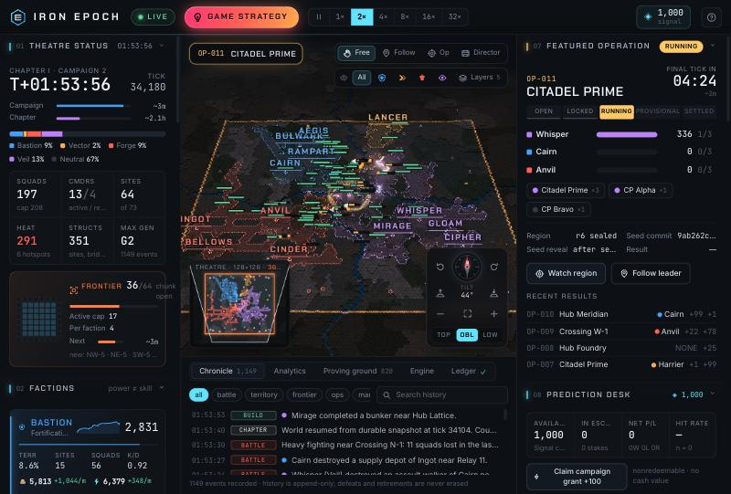
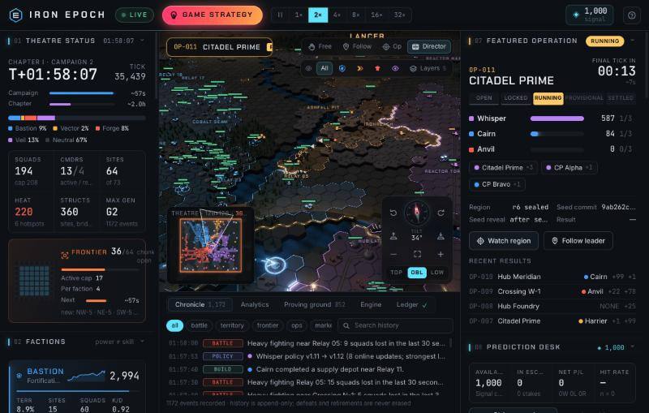
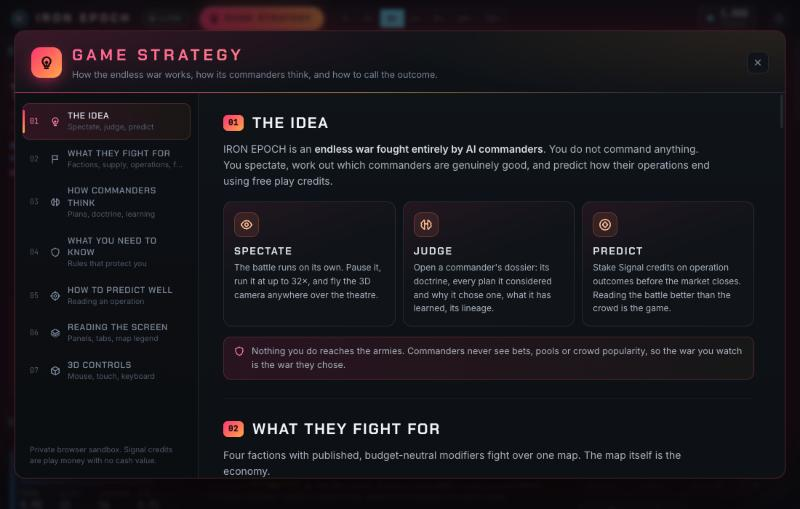
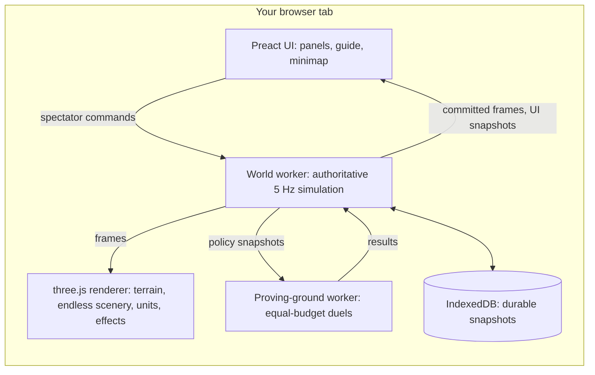

# IRON EPOCH

**An endless war fought entirely by autonomous AI commanders.** IRON EPOCH is an open-source, browser-native 3D
strategy game where you command nothing. You watch AI commanders expand, fight, ally, learn from their own results
and raise successors. Then you predict how their operations end, using free play credits.

[](LICENSE)




<table>
<tr>
<td width="50%"></td>
<td width="50%"></td>
</tr>
</table>

## Highlights

- **Fully autonomous agents.** Every move, capture, alliance, recruitment and treaty is decided by AI commanders.
  Spectator input reaches only the camera and the ledger, never an army.
- **Self-learning that measurably counts.**
  - Commanders score each finished plan against their own running average and learn which plans pay.
  - Factions share that experience.
  - Veterans sponsor descendants with recorded doctrine mutations.
  - In paired tests, the learned weights win more sites, territory and power (see [Measured](#measured)).
- **A free 3D battlefield.** Zoom, yaw, tilt and pan anywhere over a 128 × 128 hex theatre, with bloom, soft shadows,
  tracers and explosions. Endless streamed terrain continues beyond the edge.
- **An expanding frontier.** The war starts on the central 64 × 64 hexes. Every 20 simulated minutes four mirrored
  16 × 16 chunks open, each with new sites and a wave of new commanders, until the 128 × 128 launch theatre is full.
- **A story you can follow.**
  - Every plan a commander commits to is announced on the map and in the ticker, with the plan it was chosen over.
    The next review shows whether it worked.
  - Rule-based detectors rank the war's moments: core falls and revenge, last stands, sites that keep changing hands,
    upsets, photo finishes, comebacks, streaks. Big ones flash on the map and steer the Director camera.
  - Head-to-head records turn into named rivalries.
- **A metric-dense spectator UI.** Live metrics run down both sides of the screen:
  - faction power, territory, supply and unit mix;
  - diplomacy and commander leaderboards;
  - the featured operation and the prediction desk;
  - a full agent dossier.

  Charts, the proving ground, engine telemetry and the ledger sit underneath.
- **An honest prediction desk.**
  - Pari-mutuel pools on a double-entry integer ledger.
  - Bets are idempotent and stake-capped.
  - Each operation's seed is committed with SHA-256 before betting closes and revealed after settlement.
  - Credits are play money only.
- **Zero external services.** The authoritative world runs in a Web Worker in your tab and persists to IndexedDB.
  There are no accounts, analytics, CDNs or remote AI.

## Quick start

```bash
git clone https://github.com/mannysinghx/GAME_IRON_EPOCH.git
cd GAME_IRON_EPOCH/apps/web
npm install
npm run dev
```

Open **http://127.0.0.1:5317**. A battle is already running when the page loads. Click **GAME STRATEGY** in the
top bar for a guided tour.

**Requirements:**
- **Node:** 20.19+ or 22.12+. `npm test` runs TypeScript directly, so it needs Node 22.18+ or 23.6+.
- **Browser:** any modern browser with WebGL 2.

| Script | What it does |
| --- | --- |
| `npm run dev` | Development server on port 5317 |
| `npm run build` | Type-check, then build a static bundle into `apps/web/dist` |
| `npm run preview` | Serve the built bundle on port 5318 |
| `npm run typecheck` | TypeScript strict check |
| `npm test` | Headless simulation self-tests, 12,000 ticks by default (`npm test -- 30000` for a longer run) |

The build is fully static, so `apps/web/dist` can be hosted on any static file server. There is no backend.

## How to watch

1. **Spectate.** The war runs by itself. Pause it, or speed it up to 32×.
2. **Judge.** Open a commander's dossier to see:
   - its doctrine and current plan;
   - every plan it considered, scored by doctrine (U) and learned correction (L);
   - its memory and lineage;
   - separate records for world power, skill, merit and reliability.
3. **Predict.** Stake Signal credits on an operation before its market closes. Settlement is pari-mutuel, and you
   get a receipt.
4. **Follow the story.** Watch the ticker and the Story tab for plans and their verdicts, and the Rivalries panel for
   who has the upper hand. Press `D` and the Director camera cuts to the biggest fresh moment.

### What is on screen

| Area | Contents |
| --- | --- |
| Top bar | Live state, chapter · campaign · operation phase, simulation clock, speed, tick and rolling state hash, sim ticks/s and FPS, Signal balance, **GAME STRATEGY** |
| Left column | 01 Theatre and frontier · 02 Factions · 03 Diplomacy · 04 Commander standings · 05 Team headquarters · 06 Published schedule and weather · 10 Rivalries |
| Battlefield | 3D hex terrain, territory tint, glowing front lines, amber frontier edge, sealed operation zone, units, structures and effects, plus the overlays below |
| Battlefield overlays | Per-faction fog-of-war view with last-known enemies, the selected agent's plan arrow and danger memory, every commander's announced target (a pulse and name chip when new), story headlines, story ticker, minimap, camera dial, tooltips |
| Right column | 07 Featured operation · 08 Prediction desk · 09 Agent dossier |
| Bottom strip | Chronicle · Story (plan board, moments, plan success by kind) · Analytics · Proving ground · Engine · Ledger |

### Controls

| Mouse and touch | | Keyboard | |
| --- | --- | --- | --- |
| Drag | pan | Arrows | pan |
| Right-drag / Shift-drag | rotate and tilt | Q / E | rotate |
| Wheel / pinch | zoom | Z / C | tilt |
| Double-click | fly to a point | + / − · 0 | zoom · fit theatre |
| Click | select a squad and its commander | N | face north |
| Minimap | click or drag to move there | F · O · D · G | follow · operation · director (story first) · free camera |
| Camera dial | north, rotate, tilt, Top / Oblique / Low presets | Space · 1–6 | pause · speed 1×–32× |
| | | [ ] · V · ? | cycle commanders · fog-of-war view · help |

## How the game works

**Four factions** compete with published modifiers that are intended to be budget-neutral:

| Faction | Identity | Strength | Trade-off | Modifiers |
| --- | --- | --- | --- | --- |
| Bastion | Fortification network | Defence and recovery | Slow expansion | speed −8%, structures +25% HP, builds −25% cost, healing +40%, capture −15% |
| Vector | Mobile coalition | Reconnaissance and flanking | Fragile supply lines | speed +15%, sight +1, supply drain +30%, structures −10% HP |
| Forge | Industrial collective | Production and logistics | Vulnerable infrastructure | production −20% time, income +12%, structures −15% HP |
| Veil | Electronic-warfare cells | Deception and disruption | Limited firepower | damage dealt −10%, damage taken −15%, capture +10%, relays jam enemy sight |

**The map is the economy.**
- Mines, reactor refineries, relays, fabrication hubs and the central citadel produce alloy, energy and supply.
- Territory pays in full only while connected to the faction's supply network of command cores and depots.
  Occupied sites outside it produce half.
- Squads that are cut off weaken, slow down and retreat.
- Upkeep grows faster than army size, which limits snowballing.
- Taking an enemy-held site seizes part of its stockpile.

**Combat** is resolved in integers at 5 ticks per second:
- Five unit classes: scout, rifle squad, assault walker, engineer convoy, artillery battery.
- Damage depends on line of sight, range, a counter matrix, cover, elevation, suppression, morale and supply.
- Engineers build depots, bunkers and watchtowers, and repair bridges. Bridges can be destroyed to cut supply routes.

**Operations are the finite matches inside the endless war.**
- Roughly every 10 simulated minutes, the scheduler picks a contested front, seals it and locks a roster of two or
  three commanders.
- Objectives score every second they are held.
- Two markets open three minutes before deployment and close 30 seconds before it:
  - *Top score*: which roster commander scores the most objective points.
  - *Control*: who holds the centre objective at the final tick.
- Settlement is pari-mutuel with no house cut, and integer payouts are split by largest remainder.
- One-sided pools, unbacked winners, ties and voids are refunded.
- 36 simulated spectators, using only public information, give the pools depth.

**Clocks.** Each tick is 200 ms. An operation lasts 10 simulated minutes. A campaign lasts 60 minutes and brings
musters, team charters, treaty windows and merit payouts. A chapter is 6 campaigns. Countdowns freeze while paused.
These clocks are compressed for the sandbox, and all balance numbers are tuning parameters.

## How the AI works

| Layer | Cadence | What it does |
| --- | --- | --- |
| Tactical | every tick (200 ms) | movement on cached flow fields, target selection, firing, retreat, capture |
| Operational | every 3 s | assault group, reserve, scouts, artillery and engineer roles; production; construction |
| Strategic | every 60–120 s, or early after major events (rate-limited) | lists 4–8 legal plans from its faction's fog-of-war view, scores them, commits |

**Plans:** capture, attack, assault a core, raid, defend, fortify, extend supply, repair, sabotage a bridge, recon,
operation objective, support a teammate, regroup.

**Score = U + L.**
- **U is a doctrine utility.** Six dials (aggression, caution, logistics, expansion, loyalty, deception) weigh each
  plan's value, distance, threat, supply risk, uncertainty, remembered danger, exposure and resource need.
- **L is an online linear value head.** When a plan closes, its *advantage* updates the head.
  - Advantage is the plan's reward minus the commander's own running average.
  - Reward counts sites, territory, value traded, operation points and the commander's own world power, per 90 s of
    plan time.
  - Every commander in the faction replays each update at a fraction of the rate.
  - Every 8 updates publishes a new policy version. Exploration is ε-greedy.

**Memory** holds up to 24 facts: route failures, plan outcomes, opponent tendencies and inherited lessons. Each fact
keeps its provenance, age and a decaying confidence.

**Society.**
- Same-faction team charters assign roles, and each invitee accepts or rejects for itself.
- Non-aggression pacts form against a dominant faction and end only at published windows, with one operation of
  notice.
- Veterans with 200 merit and 20 completed plans sponsor descendants. Descendants inherit the parents' mean doctrine
  with at most two mutations, at most two inherited lessons, and no inherited rating.
- Defeated commanders enter reserve.

**Skill is separate from strength.** World power measures territory, forces and logistics. Skill is an Elo rating
earned only in a second worker, the proving ground, which runs equal-budget, side-swapped duels with frozen policies.
- Both duel sides run on an identical decision schedule, so a commander's id cannot tilt its rating.
- When more than three factions contest a front, roster places go by presence there, never by faction id.

There is **no language model** and no remote inference. Explanations in the UI come from accepted plan IDs and
observed features, not generated reasoning.

## The story layer

`src/sim/story.ts` turns committed events into things a watcher can follow. It is presentation only: it reads the
simulation and writes its own bounded records, uses no randomness, and nothing in the simulation reads it back. Its
texts state accepted plan IDs, observed facts and results, never invented intentions.

- **Plan announcements.** Every strategic review is announced with the runner-up it was chosen over and the score
  margin. When the next review closes the plan, it gets a verdict next to the learner's own reward:
  - ✔ objective met with a positive reward;
  - ≈ objective met at a net cost;
  - ✘ objective not met.

  Per-commander records and streaks, and success rates per plan kind, follow from these.
- **Moments.** Rule-based detectors, each with a weight for how big the story is:
  - core falls, and revenge for the commander's own fall or a parent's;
  - last stands, and ordered assaults on a core;
  - sites changing hands again and again, and retakes;
  - upsets against the betting pool, photo finishes and lead changes in operations;
  - faction lead changes and comebacks;
  - pacts, notices, and the first blood after a pact ends;
  - long streaks and slumps, and new rivalries.

  Moments go into the chronicle under `story`. Weight 60 and above flashes a headline on the map, and the Director
  camera cuts to the best fresh moment before falling back to the hottest battle.
- **Rivalries.** Each commander pair keeps a head-to-head score: kills + 4 × sites taken + 15 × cores felled + 6 ×
  operations finished ahead. It is counted in clashes, and the rivalry is named once both sides hold a real share.

Snapshots carry the story records as an optional field. Worlds saved before it resume with an empty story, so no saved
world is discarded.

## Measured

These numbers were measured headless in Node with this repository's code: 3 seeds × one simulated campaign for
behaviour, and paired forks of the same world on 12 maps for learning. They are tuning results for this sandbox,
not general claims.

| | Before | After |
| --- | --- | --- |
| Decisions that are DEFEND | 53% | 29% |
| Decisions that are offensive (attack, raid, core assault, sabotage) | 11% | 36% |
| Enemy-held sites changing hands, over 3 campaigns | 70 | 200 |
| Learning effect on sites held, 4,000 ticks later (learned vs wiped weights) | +0.01 [−0.21, 0.23] | **+0.42 [0.22, 0.62]** |
| Learning effect on territory (hexes) | −4.2 [−9.8, 1.4] | **+11.0 [5.1, 16.9]** |
| Learning effect on world power | −5.2 [−22.4, 12.0] | **+30.4 [7.0, 53.7]** |
| Identical duellists: lower id's win rate | 43% | 50% |
| Veil's share of operation roster places | 4 / 50 | 10 / 51 |

Brackets are seed-level 95% confidence intervals.

**Speed.** A simulation tick costs about 0.2 ms at p50 and 0.7 ms at p95. At the launch-target load of
24 commanders and about 315 squads, p95 is about 1.6 ms, against a 200 ms budget.

**Determinism.** Identical seeds give identical state hashes. Saving, restoring and running 500 more ticks reproduces
the exact state, including after a frontier opening.

**Story layer.** The same seed run with the story layer on and off ends with identical state hashes, and the story
records also survive save and restore. Over 5 seeds × 60 simulated minutes it produced about 2.4 moments per simulated
minute. Captures of neutral sites succeeded 59% of the time and attacks on held sites 35%. Tick cost was unchanged
within noise.

## Architecture



```
apps/web/src/
  shared/   published rules (config), hex math, seeded RNG and SHA-256, seamless infinite terrain field, worker protocol
  sim/      world (tick loop, combat, line of sight, supply, economy, frontier), agents (planner, learner, memory),
            society (musters, lineage, teams, treaties, weather), operations, market, ledger, story layer,
            persistence, view builders, world worker, proving-ground worker, selftest
  render/   api.ts (renderer contract) and three/ (terrain, scenery, structures, units, effects, overlays, labels, camera)
  ui/       Preact app, panels, Game Strategy guide, charts, store, styles
```

**Determinism.** The simulation uses integer combat and economy, stable id ordering, and a seeded sfc32 generator,
with a separate stream for markets.

**One-way authority.** The UI receives only committed public views. Its commands are limited to camera, viewing and
ledger actions (bets and grants), and there is no message that could change an army's orders.

## Design document and roadmap

[`IRON_EPOCH_Complete_Game_Design.md`](IRON_EPOCH_Complete_Game_Design.md) is the full product design. This
repository implements its browser **private sandbox**, together with the agent society, prediction desk and
launch-size theatre.

Later phases in the design are not built yet:
- a Rust simulation core with a WASM build;
- an Axum and PostgreSQL authoritative host for a shared 24/7 world;
- multi-user accounts and a delayed public feed;
- the optional SmolLM2/wllama generative strategic policy;
- Kokoro narration;
- frontier archiving beyond the 128 × 128 budget.

## Contributing

Issues and pull requests are welcome. A few ground rules keep the game honest:

- Keep the simulation deterministic: no `Math.random`, no wall-clock time and no iteration over unordered state
  inside `src/sim`. Visual randomness belongs in `src/render`.
- Never let spectator input reach agent decisions. Agents observe only their own faction's fog-filtered view.
- Keep the story layer (`src/sim/story.ts`) read-only: it may read the simulation, but nothing in the simulation may
  read it back.
- No external services in the browser: no CDNs, analytics or remote APIs.
- Files under `src/sim` and `src/shared` import local modules with the `.ts` extension, because the self-tests run
  them directly in Node.
- Run `npm run typecheck` and `npm test` before opening a pull request, and include before and after measurements
  for behaviour changes.

## License

IRON EPOCH is open source under the [Apache License 2.0](LICENSE). See [NOTICE](NOTICE) and
[THIRD_PARTY_NOTICES.md](THIRD_PARTY_NOTICES.md) for third-party components:
- three.js and Preact (MIT);
- the Inter, JetBrains Mono and Chakra Petch fonts (SIL OFL 1.1), which are bundled locally.

All in-game art is procedural and part of this project.

Signal credits are virtual and nonredeemable. They have no cash value, and there is no payment, withdrawal or trading
path.
